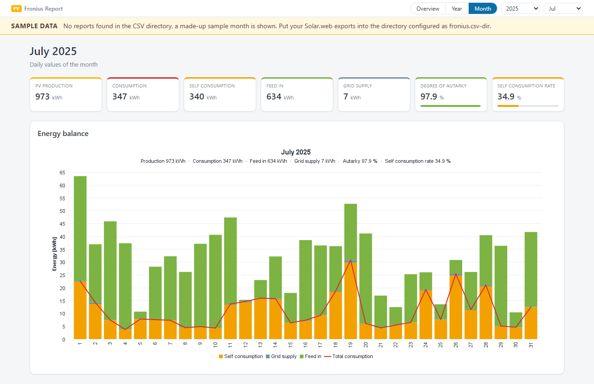

# FroniusReportServer

A small Spring Boot server that shows the monthly CSV reports of a Fronius
inverter (exported from [Solar.web](https://www.solarweb.com)) as charts. It
was written for a Fronius Symo GEN24 8.0 Plus but only depends on the
Solar.web export.

The code is in English throughout; the user interface is localized (English
and German).

## Quick start

Requires Java 21, e.g. [Eclipse Temurin](https://adoptium.net).

Download `FroniusReportServer-<version>.zip` from the
[releases](../../releases), unpack it and run `start.cmd` (Windows, see
[Running on Windows](#running-on-windows)) or
`java -jar FroniusReportServer.jar` (any platform). To build it yourself:

    mvn clean package
    java -jar target/FroniusReportServer.jar

Then open <http://localhost:8084/> (redirects to the most recent month).

Without any configuration the server shows a bundled **sample month** (July
2025, made-up values) and marks it with a "Sample data" banner. As soon as the
configured CSV directory holds at least one report, the sample is replaced by
your own data - no restart needed.

## Your own reports

1. In Solar.web, export the monthly **energy balance** report as CSV for every
   month you want to see.
2. Put the files into one sub directory per year:

        /path/to/csv/
          2025/
            Energiebilanz_Monatlicher_Report_2025_06.csv
            Energiebilanz_Monatlicher_Report_2025_07.csv
          2026/
            ...

3. Create `local.properties` in the working directory (see below) and set
   `fronius.csv-dir=/path/to/csv`.

The expected file contains two header lines (column names, units) and one line
per day with total production, total consumption, self-consumption, energy fed
into the grid and energy drawn from the grid. Other reports, such as
`Produktion_Monatlicher_Report_*.csv`, are not read.

To try the server with the sample file as if it were a real report, copy
`src/main/resources/demo/Energiebilanz_Monatlicher_Report_2025_07.csv` into
`<csv-dir>/2025/`.

### Exports in other languages

Solar.web localizes its exports: the file name and the column headers depend on
the language of your account. The defaults match the German export. For an
export in another language, set the file name pattern and the column headers of
your files in `local.properties`, for example:

    fronius.csv.file-pattern=Energy_balance_Monthly_report_{year}_{month}.csv
    fronius.csv.date-format=MM/dd/yyyy
    fronius.csv.columns.production=Total production
    fronius.csv.columns.consumption=Total consumption
    fronius.csv.columns.self-consumption=Self-consumption
    fronius.csv.columns.feed-in=Energy fed into grid
    fronius.csv.columns.grid-supply=Energy drawn from grid

(The names above are only an example - copy the exact ones from your file.)

The reader is tolerant where it can be:

* the delimiter (`,` or `;`) and the decimal separator (`.` or `,`) are
  detected, quoted values are accepted,
* the unit is read from the second header line (`[Wh]` or `[kWh]`),
* dates in ISO format (`yyyy-MM-dd`) are always accepted,
* a column header that is not found falls back to the usual position of the
  column (date, production, consumption, self-consumption, feed-in, grid
  supply) and a warning is logged.

## Configuration

The packaged defaults live in `src/main/resources/application.properties`. Do
not change them for your installation - put your settings into
**`local.properties`** in the working directory instead (the project directory
when started from the IDE, the deployment directory when run as a service).
It is optional and overrides every key it contains. A template is
`src/dist/local.properties.example`. Keep `local.properties` out of version
control.

| Key                         | Default         | Meaning                                                    |
|-----------------------------|-----------------|------------------------------------------------------------|
| `fronius.csv-dir`           | (empty)         | Root directory of the reports, one sub directory per year  |
| `fronius.plant-name`        | (empty)         | Name of the pv plant, shown as tooltip of the branding     |
| `fronius.demo-fallback`     | `true`          | Show the sample month while no report is found             |
| `fronius.refresh-cron`      | `0 5 * * * *`   | Schedule of the directory scan, `-` disables it            |
| `fronius.chart-width`       | `1100`          | Chart width in pixels                                      |
| `fronius.chart-height`      | `480`           | Chart height in pixels                                     |
| `fronius.csv.file-pattern`  | `Energiebilanz_Monatlicher_Report_{year}_{month}.csv` | File name of a monthly report |
| `fronius.csv.date-format`   | `dd.MM.yyyy`    | Format of the date column                                  |
| `fronius.csv.columns.*`     | German headers  | Column headers, see above                                  |
| `spring.web.locale`         | `en`            | Language of the user interface: `en` or `de`               |
| `server.port`               | `8084`          | HTTP port                                                  |

On Windows use forward slashes (`fronius.csv-dir=C:/path/to/csv`); backslashes
would have to be doubled in a properties file.
Every key can also be given on the command line, e.g.
`--fronius.csv-dir=/path/to/csv --server.port=9090`.

## Localization

The user interface language is set with `spring.web.locale` (`en` or `de`).
The texts live in `src/main/resources`:

* `messages.properties` - English, also the fallback for unknown languages
* `messages_de.properties` - German

Both files are encoded in **ISO-8859-1** (`spring.messages.encoding`), not
UTF-8. Another language only needs another `messages_xx.properties`; a test
makes sure that every language has the same keys.

## Distribution zip

Besides the executable jar, `mvn clean package` also creates
`target/FroniusReportServer.zip`, the same zip that is attached to a release.
It serves every platform:

    FroniusReportServer.jar           the server
    start.cmd                         Windows: start in a console window
    start, install.sh,                Linux: run as a systemd service
    fronius_report_server.service
    local.properties.example          template of the settings
    README.md, LICENSE

The assembly fixes the line endings per file (Windows for `start.cmd`, Unix
for the Linux files), so it does not matter where the zip is built.

## Running on Windows

1. Install Java 21, e.g. [Eclipse Temurin](https://adoptium.net) (tick
   "Set JAVA_HOME" or "Add to PATH" in the installer).
2. Unpack the zip into a directory of your choice, e.g.
   `C:\Tools\FroniusReportServer`.
3. Copy `local.properties.example` to `local.properties` and set
   `fronius.csv-dir`, with forward slashes: `fronius.csv-dir=C:/path/to/csv`.
   Without it the server shows the sample month.
4. Double-click `start.cmd` and open <http://localhost:8084/>.

`start.cmd` uses the Java of `JAVA_HOME`, otherwise the `java` on the path,
and reports clearly if none is found. The server runs as long as the console
window is open; closing the window stops it. Arguments are passed on, e.g.
`start.cmd --server.port=9090`.

To start it automatically when you log on, put a shortcut to `start.cmd` into
the startup folder (`Win+R`, `shell:startup`). To run it without anybody being
logged on, create a task in the Task Scheduler with the trigger "At startup",
the action "Start a program" `C:\Tools\FroniusReportServer\start.cmd` and
"Run whether user is logged on or not". A real Windows service is not
provided.

## Running as a Linux service

First installation, e.g. in `/opt/fronius_report_server`:

    scp target/FroniusReportServer.zip <user>@<server>:/opt/fronius_report_server/
    ssh <user>@<server>
    cd /opt/fronius_report_server && unzip -o FroniusReportServer.zip
    sudo ./install.sh

`install.sh` asks for the service user, the install directory and the Java
executable, suggesting the calling user, its own directory and the `java` on
the path - Enter accepts a suggestion. `sudo ./install.sh -y` takes the
suggestions without asking. The script checks the values, writes the unit to
`/etc/systemd/system/`, enables and starts the service. On the first run it
also creates `local.properties` from the example; set `fronius.csv-dir` there
and restart.

New version:

    scp target/FroniusReportServer.zip <user>@<server>:/opt/fronius_report_server/
    ssh <user>@<server>
    cd /opt/fronius_report_server && unzip -o FroniusReportServer.zip
    sudo systemctl restart fronius_report_server

The zip does not contain `local.properties`, so unpacking never overwrites the
settings of the installation.

`start` launches the JVM via `exec`, so it becomes the main process of the
service and `systemctl stop/restart` signals it directly. The heap is limited
to 256 MB; in operation the server uses about 145 MB.

Status and log:

    systemctl status fronius_report_server
    journalctl -u fronius_report_server -f

## Releases

A release is built by GitHub Actions (`.github/workflows/release.yml`):

1. Set the version in `pom.xml`, e.g. `1.1.0`, and commit.
2. Tag the commit and push the tag:

        git tag v1.1.0
        git push origin v1.1.0

3. The workflow builds and tests the server, checks that the tag matches the
   version in `pom.xml` and attaches `FroniusReportServer-1.1.0.zip` to a
   **draft** release.
4. Check the draft on GitHub and publish it.

## Pages and endpoints

| Path                    | Content                                                       |
|-------------------------|---------------------------------------------------------------|
| `/`                     | Redirect to the most recent month                             |
| `/month/{year}/{month}` | Daily values of a month                                       |
| `/year/{year}`          | Monthly totals of a year                                      |
| `/overview`             | Yearly totals of all years                                    |
| `/select`               | Target of the selection form, redirects to the canonical path |
| `/api/report`           | The view model as JSON, used by the thin client               |
| `/chart.png`            | Chart as PNG (JFreeChart, rendered on the server)             |

Parameters of `/chart.png`, `/api/report` and `/select`:
`view=overview|year|month`, `year`, `month`; `/chart.png` additionally accepts
optional `width` and `height`.

Incomplete input is completed: without a year the most recent one is used,
without a month the last one of the selected year.

## Thin client

The selection bar is a form that also works without JavaScript - `/select`
then redirects to the canonical path. If JavaScript is available,
`static/js/thin-client.js` takes over: on every change it fetches the view
model from `/api/report`, swaps title, key figures and the chart image, and
writes the new path into the address bar via `history.pushState` - without a
page reload.

The client is deliberately dumb: `/api/report` returns the same view model the
server renders into the page, with texts already translated and numbers already
formatted. The client knows neither the language nor number formats.

## Tooltips over the bars

The charts remain PNGs rendered on the server. While drawing, JFreeChart
records the area of every drawn segment (`ChartRenderingInfo`). From this,
`ChartFactory.buildHover(...)` builds a model that is handed to the page
(`ChartHover`, embedded in the HTML as JSON in `#chart-hover`, delivered to the
thin client via `/api/report`):

* the area of the plot - nothing happens outside of it,
* one **column** per category, extending halfway to its neighbour, so the whole
  plot area is covered without gaps,
* all values per column (self-consumption, grid supply, feed-in, plus the
  total consumption as a sum row), already translated and formatted,
* the upper and lower edge of each value's segment.

When hovering over a column, the thin client shows **all values at once** and
highlights the one whose segment is under the pointer, so there is no need to
hit a single bar segment. The intervals are half-open (`y1 <= y < y2`) because
adjacent segments share their boundary - this way exactly one row is always
highlighted. The consumption line deliberately has no geometry: it appears as
the sum row in the tooltip but is never highlighted.

In addition, the server still generates a classic **HTML image map** with one
`<area>` per value. It is the fallback without JavaScript - the browser then
shows its native (delayed) tooltips for a single segment. With JavaScript
active, the client removes `usemap` so that both do not appear.

Two things need attention:

* **The image size must not be changed via CSS.** Image map coordinates do not
  scale along, so the areas would shift relative to the bars. The image is
  therefore shown in its natural size (`fronius.chart-width`); in a narrower
  window `.chart-frame` scrolls horizontally. For the same reason the page's
  image map no longer fits if `/chart.png` is requested manually with a
  different `width`.
* **Every `<area>` needs an `href`**, otherwise browsers do not hit-test it and
  the tooltip never appears. It is set to `#`; the thin client intercepts the
  click, without JavaScript it jumps to the top of the page.

For the page to deliver the map, the chart must already be rendered while the
page is being built - the browser fetches the image itself only afterwards.
`ChartService` therefore keeps the last 16 renderings, so the subsequent
`/chart.png` request is served from the cache (~8 ms instead of ~30 ms). The
cache key contains the chart's values, so a changed report automatically leads
to a new rendering.

## New reports

A newly added report becomes visible **without a restart**. Two mechanisms
work independently of each other:

1. **On every request.** The directory is scanned on each request; a cached
   month is discarded and re-read based on its file's modification timestamp.
   This alone is already sufficient.
2. **Periodically (`ReportRefreshTask`).** In addition, a cron job scans the
   directory - at startup and then according to `fronius.refresh-cron`, by
   default five minutes past every full hour. It reads new or changed reports
   into the cache and drops entries whose file has disappeared.

So the cron job is not required, but keeps the cache warm: the first request
after an export is fast right away, and a broken export shows up in the log
instead of only when clicking. An error during the scan is logged and does not
stop the scheduler.

In the log it looks like this:

    Rescan of the report directory: 1 report(s) read, 0 dropped, 66 available.

Disable it with `--fronius.refresh-cron=-`.

### Battery

The reports contain **no** battery columns (charge, discharge, state of
charge), so these values cannot be displayed. Instead, the page shows the two
key figures that Solar.web also features prominently:

* **Degree of autarky** = self-consumption / consumption
* **Self-consumption rate** = self-consumption / production

## Structure

    de.latzig.tool.fronius.report.server
      config/    FroniusProperties            Configuration
      csv/       CsvReportReader              Parsing of the CSV exports
      i18n/      Messages                     Access to the localized texts
      model/     DayValues, MonthReport,      Data model
                 PeriodSummary
                 PeriodView, PeriodSelection  Period selection
      service/   ReportRepository             Lazy loading + cache + rescan
                 DemoReports                  Bundled sample month
                 ReportRefreshTask            Cron job for the rescan
                 ChartDataService             Reports -> chart categories
                 ChartService                 Renders PNG + image map, cache
      chart/     ChartFactory, ChartRow       JFreeChart charts
                 ChartHover                   Tooltip model per category
      web/       ReportController             HTML pages (Thymeleaf)
                 ReportApiController          /api/report for the thin client
                 ChartController              /chart.png
                 ReportViewModelFactory       Builds the view model
                 ReportViewModel
                 JsonWriter                   JSON for the template

## License

MIT, see [LICENSE](LICENSE).

Third-party libraries bundled into the executable jar keep their own licenses,
among them Spring Boot (Apache 2.0) and JFreeChart (LGPL 2.1).

Fronius and Solar.web are trademarks of Fronius International GmbH. This
project is not affiliated with Fronius.
